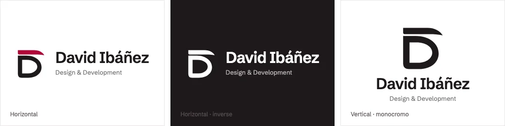
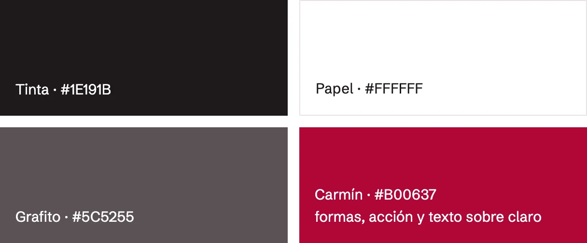
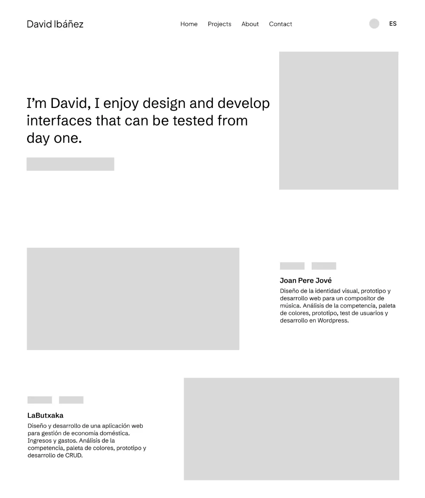
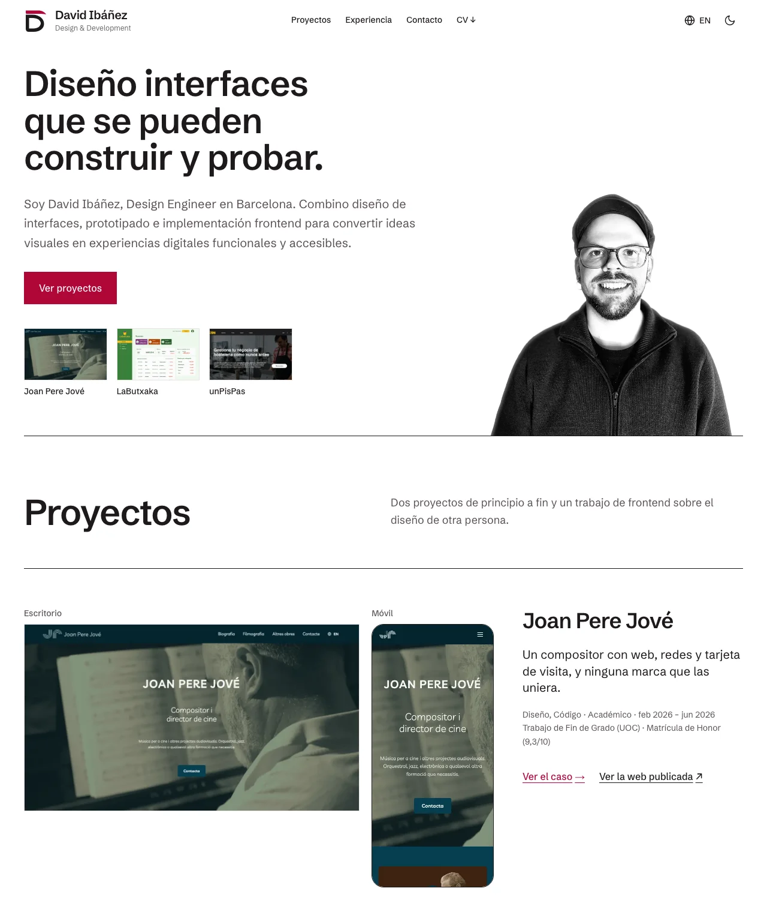
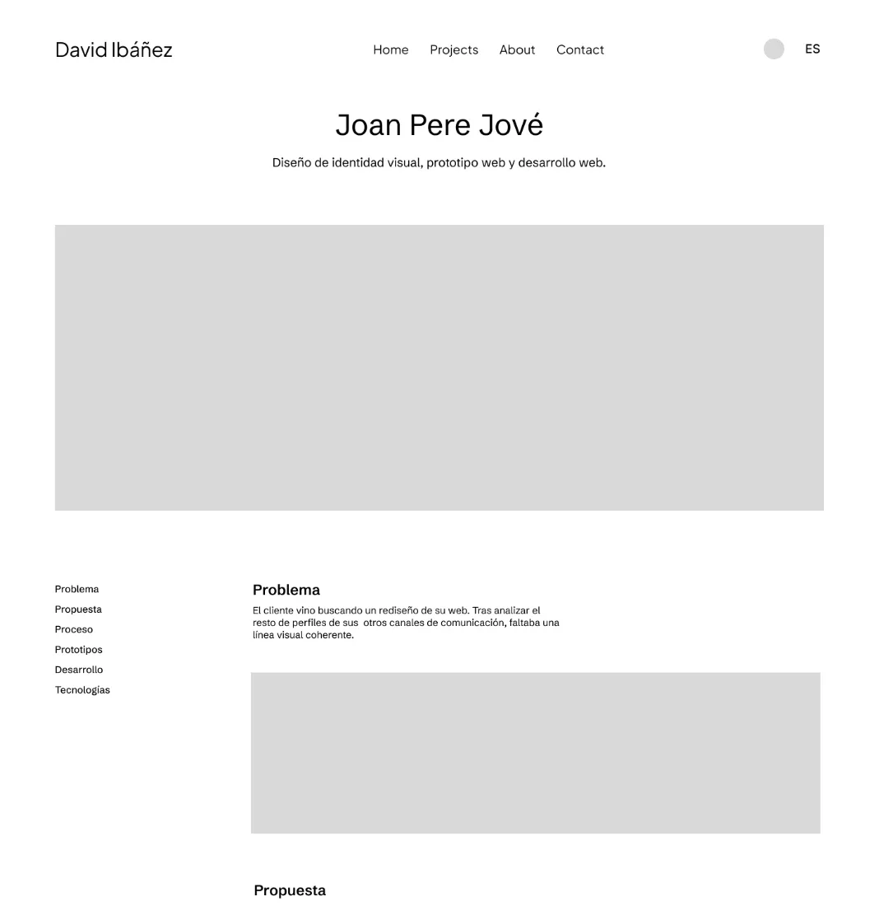
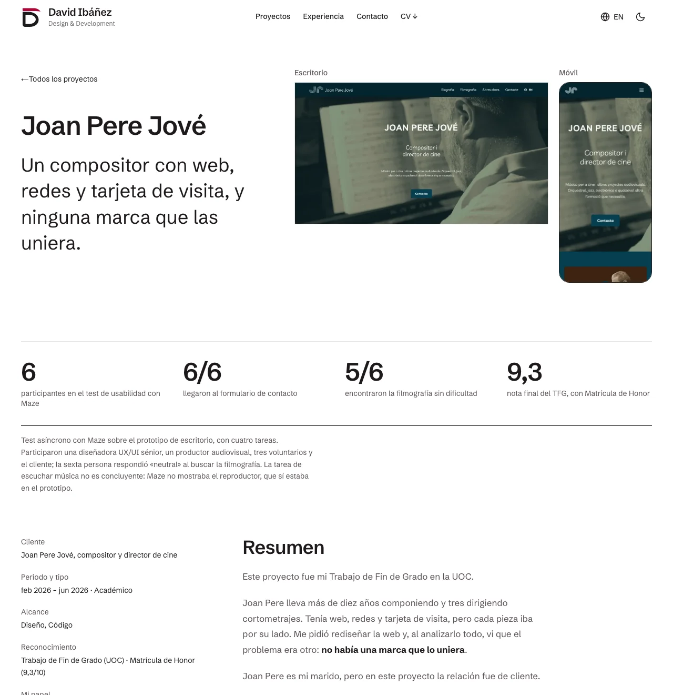
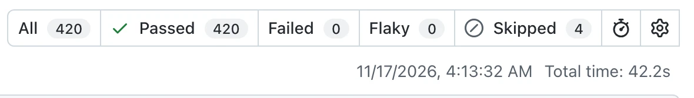

## Visual identity

I started with the brand. I took my black-and-white portraits as the starting point and, with Claude Code, looked for a mark that came out of them: a **D wearing a cap**. The D is flat on top because of how I wear my cap. The belly of the D wide as my face, and the brim is short.

The brim is the signature and the only touch of color: crimson on a white background and pink on a dark one. The pink keeps the contrast and also closer to the LGBTIQ+ community.

The palette also came from the photos: ink (a black with a warm tint), paper and graphite, with plenty of contrast, and crimson for the brim, the links and the main action. The typeface is Schibsted Grotesk, a grotesque designed for the Schibsted group's newspapers. I build the whole site with it, from 72 px headlines to the 14 px data in the project details, without a second family: the hierarchy comes from size, weight and space.

The first version was different: an orange brim on an off-white background, Plus Jakarta Sans and a monospaced font for the role. I dropped it because that combination looked a lot like any AI-generated website, and I wanted it to have more personality. I documented everything on a brand page with lockups, favicon, avatar and colors.

<figure>

<figcaption>The logo in horizontal, inverse and vertical versions.</figcaption>

</figure>

<figure>

<figcaption>The palette: three neutrals and a single accent.</figcaption>

</figure>

## Wireframe in Figma

Before writing any code I built the wireframe in Figma with the structure of the home page, a case study and the hierarchy of each block. It helped me decide what to tell and in what order without getting lost in styling, and gave me a reference to check Claude Code's proposals against.

<figure class="figure-pair">

<figcaption>The home page, from the Figma wireframe to the published site.</figcaption>

</figure>

<figure class="figure-pair">

<figcaption>A case study: the side index stayed; the image moved next to the title and the figures were added.</figcaption>

</figure>

## Building with Astro

I built the site with **Astro** and **Tailwind CSS**. I chose this stack because I had read that it improves the performance of the site and I wanted to try it on a project of my own. Three groundwork decisions:

- **Content apart from code.** The case studies are Markdown files in Astro collections, with a schema that validates their data: if a case is missing its date or the alt text of its screenshots, the build fails.
- **Two languages.** Spanish at the root and English under `/en/`, with browser language detection and matching pages and anchors when you switch.
- **Dark mode.** Colors are variables, so each theme changes their values without touching the components.

**Claude Code** wrote the code. I decided what to do, reviewed every change and chose between the alternatives it suggested. To review the interface I used two design skills, UI/UX Pro Max and Impeccable. Impeccable scores each screen and points out specific problems.

Some proposals I applied:

- **The work on the first screen.** The critique noticed that the home page only showed text and that the CV was at the bottom of the footer. I added thumbnails of the three projects under the headline and moved the CV to the header.
- **A shorter header on mobile.** The sticky header was 88 px tall and took up almost 10% of a phone screen. First I made it shrink on scroll, but on mobile it flickered, so I fixed it at 56 px. On desktop it does shrink, from 88 to 56 px.

Others I rejected:

- **The copy-email button.** I added it to the footer and removed it the next day: the email link already did that job, and the button was one thing too many.
- **Removing the white sheet behind the portrait in dark mode.** The critique pointed out that, in dark mode, the white background of the photo was the brightest thing on the screen. I tried cutting out the portrait, but went back to the white sheet because the cutout left a white halo that was too bright around the silhouette, especially around the ears.

## Accessibility

I take accessibility into account from the early stages of a project, so my own site had to meet at least WCAG level AA.

**Contrast decided the colors.** I measured every combination before accepting it. Crimson works on white, but on a black background it doesn't even reach the minimum WCAG asks for shapes, so on dark backgrounds I replaced it with two pinks: one for dark mode and a slightly lighter one for the footer.

| Combination | Contrast | Use |
| --- | --- | --- |
| Crimson #B00637 on paper #FFFFFF | 7.2:1 | Main button, links and brim |
| Crimson #B00637 on ink #1E191B | 2.4:1 | Rejected: below 3:1 |
| Accent pink #E24E70 on the dark background #151214 | 4.9:1 | Links and brim in dark mode |
| Footer pink #EC5F80 on ink #1E191B | 5.4:1 | Footer links |
| Graphite #5C5255 on paper #FFFFFF | 7.5:1 | Secondary text |

**Focus is visible.** One of the first critiques found that the main button had a white outline on a white background. If you navigated with a keyboard, the focus disappeared. I replaced it with a 2 px outline in the text color on every element.

**44 px touch targets.** The links in the header, the footer and the case studies are at least 44 px tall, so you can tap them with your thumb without needing luck.

**Motion only if you want it.** If your system asks for reduced motion, the site removes the entrance animations, the blocks that appear on scroll and the transition between pages.

**For screen readers.** Every page has a link to skip to the content. External links announce that they open in a new tab, and videos have a description. The content schema also won't let me publish a case if any of its main screenshots lacks alt text.

## Tests with Playwright

Since quality is what I do at work, I wanted the portfolio to have its own e2e tests. With **Playwright** I check every content page on desktop and mobile:

- It loads with no console errors or broken resources.
- It declares its language and has a title, a meta description and a single `h1`.
- There is no horizontal scroll.
- There are no WCAG 2.1 AA violations, checked with **axe**.
- Visual regression against reference screenshots of each page. I run this one locally, because the screenshots are generated on macOS and GitHub's server would render the fonts differently.

<figure>

<figcaption>Playwright report: 420 tests passed on desktop and mobile.</figcaption>

</figure>

## Deploying to GitHub Pages

Every time I push changes to the `main` branch, **GitHub Actions** builds the site once, runs the tests against that same build (all except visual regression) and, if everything passes, publishes it to **GitHub Pages**. That way, what reaches the site is the same build the tests checked.

I bought the domain, davidib.com, from **Hostinger** and pointed it to GitHub Pages in the DNS settings.

## External review

Once the site was live, I asked a senior Design Engineer to tell me its strengths and weaknesses. Of their suggestions, I applied two and rejected one:

- **Transition between pages.** When you go from one page to another, the new one appears with a short 0.3-second fade instead of switching abruptly, and the header stays still. It respects the reduced-motion preference. Before, the animation was only on the home page.
- **Metrics in the case studies.** Each case now opens with three or four real figures and a note explaining where they come from.
- **Rounded corners on buttons.** They suggested them to soften the interface, but I kept the square corners. They fit the thin lines and the solid D of the logo, and with rounded corners the site would look like many others.

## What I learned

Claude Code wrote the code; what took me longest was deciding what to tell and what I could defend in an interview. I also rewrote the unPisPas case study and created a demo version so I could link to it.

The tests let me change things calmly. I redid the home page several times and, when something broke, Playwright told me before I published. And starting with the identity saved me decisions later: with the palette and typeface settled, I could keep moving on building the components and pages.
