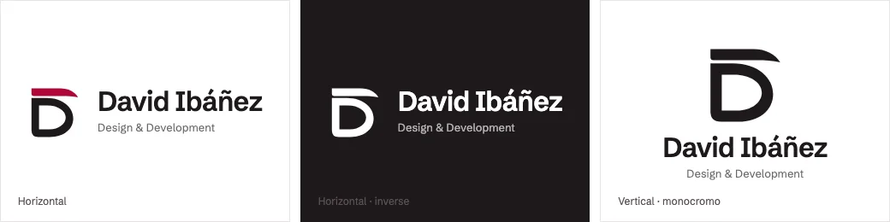
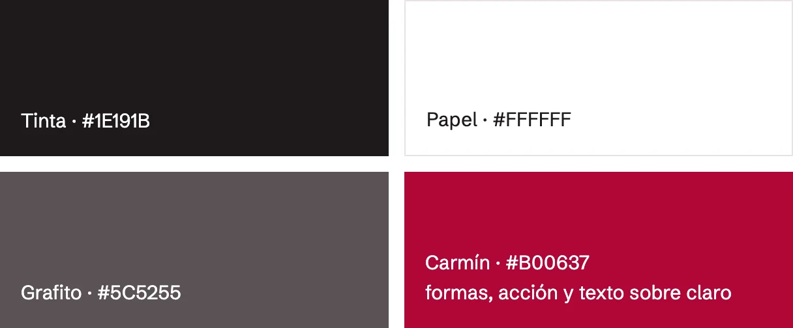
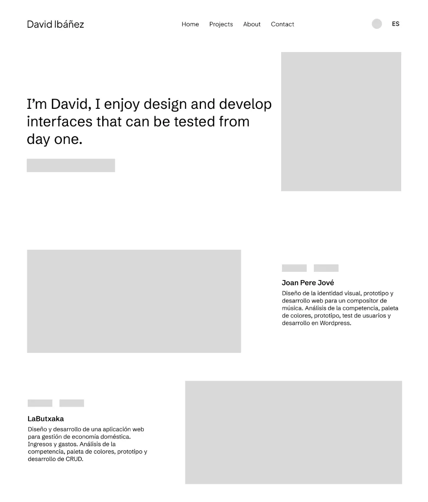
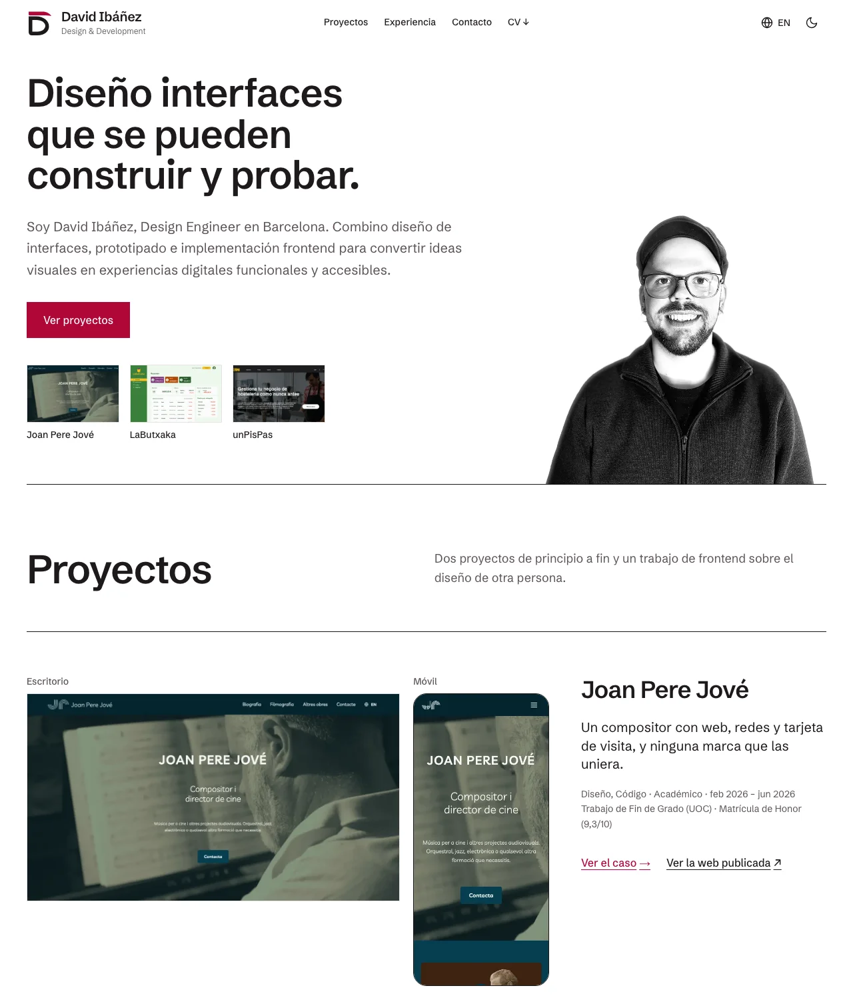
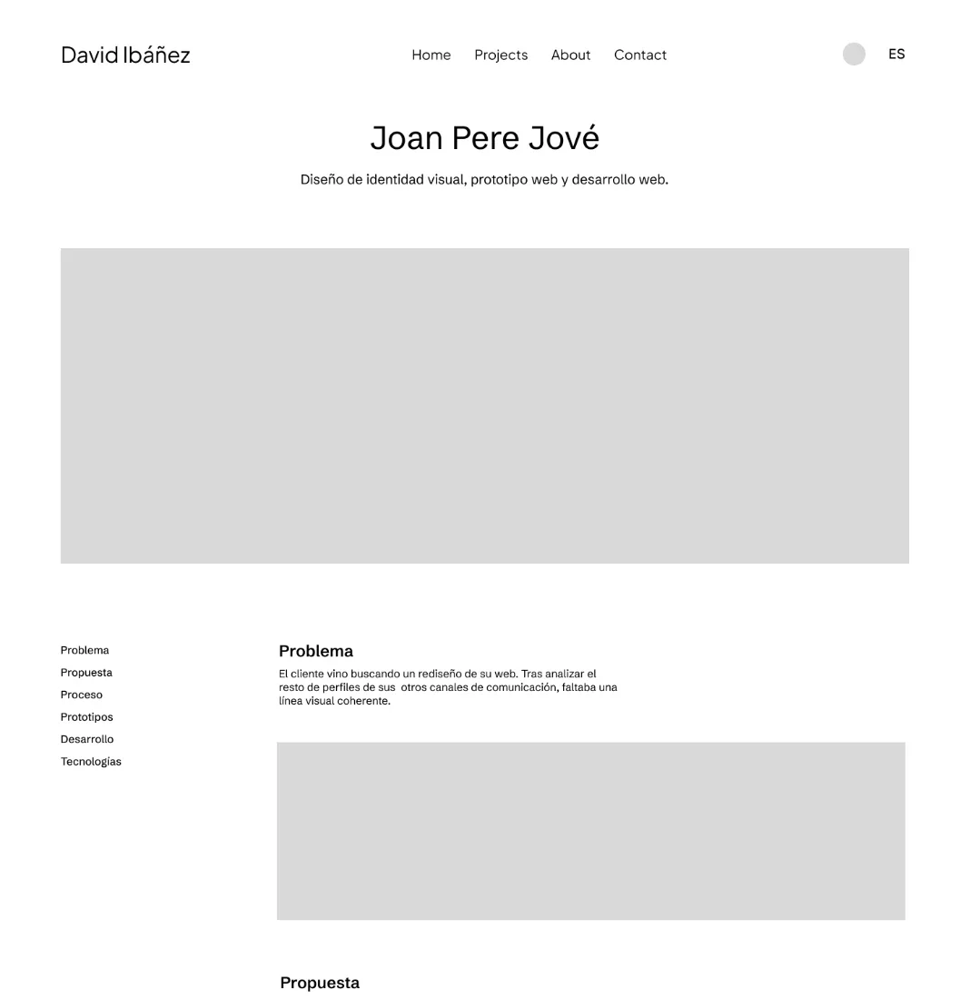
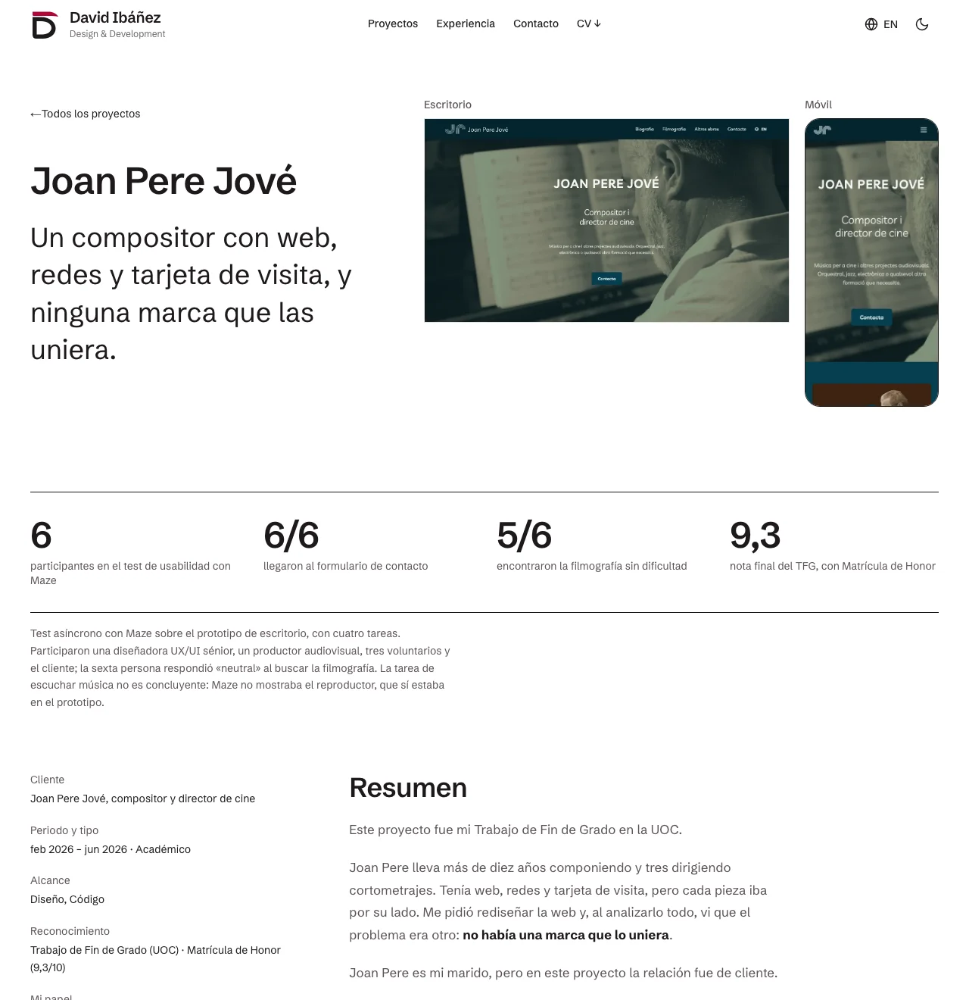
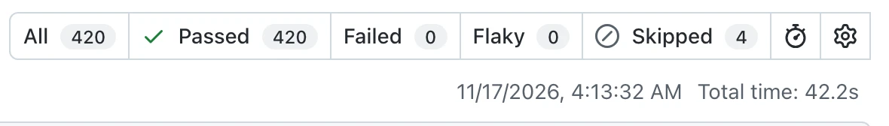

## Identidad gráfica

Empecé por la marca. Partí de mis retratos en blanco y negro y, con Claude Code, busqué un isotipo que saliera de ellos: una **D con gorra calada**. La D es plana arriba porque llevo la gorra baja, justo sobre las gafas. La barriga es ancha como mi cara, y la visera es corta.

La visera es la seña de identidad y el único punto de color: carmín sobre fondo blanco y rosa sobre fondo oscuro. El rosa mantiene el contraste y, de paso, hago un guiño a la comunidad LGBTIQ+.

De las fotos saqué también la paleta: tinta (un negro con un matiz cálido), papel y grafito, con mucho contraste, y el carmín para la visera, los enlaces y la acción principal. La tipografía es Schibsted Grotesk, una grotesca diseñada para los periódicos del grupo Schibsted. Con ella monto toda la web, desde los titulares de 72 px hasta los datos de 14 px de las fichas, sin una segunda familia: la jerarquía sale del tamaño, el peso y el espacio.

La primera versión era distinta: visera naranja sobre un fondo blanco roto, Plus Jakarta Sans y una fuente monoespaciada para el rol. La descarté porque esa combinación generaba un fondo bastante parecido al de cualquier web generada con IA y quería darle más personalidad. Lo recogí todo en una página de marca con lockups, favicon, avatar y colores.

<figure>

<figcaption>El logotipo en horizontal, en negativo y en vertical.</figcaption>

</figure>

<figure>

<figcaption>La paleta: tres neutros y un solo acento.</figcaption>

</figure>

## Wireframe en Figma

Antes de escribir código monté el wireframe en Figma con la estructura de la portada, un caso de estudio y la jerarquía de cada bloque. Me sirvió para decidir qué contar y en qué orden sin perderme en el estilo, y para tener una referencia con la que revisar las propuestas de Claude Code.

<figure class="figure-pair">

<figcaption>La portada, del wireframe en Figma a la web publicada.</figcaption>

</figure>

<figure class="figure-pair">

<figcaption>Un caso de estudio: el índice lateral se mantuvo; la imagen pasó al lado del título y se sumaron las cifras.</figcaption>

</figure>

## Desarrollo con Astro

Construí el sitio con **Astro** y **Tailwind CSS**. Elegí Astro porque había leído que mejora el rendimiento de la web y tenía ganas de probarlo en un proyecto personal. Tres decisiones de base:

- **Contenido separado del código.** Los casos de estudio son archivos Markdown en colecciones de Astro, con un esquema que valida sus datos: si a un caso le falta la fecha o el texto alternativo de sus capturas, el build falla.
- **Dos idiomas.** Español en la raíz e inglés bajo `/en/`, con detección del idioma del navegador y equivalencia de páginas y anclas al cambiar.
- **Modo oscuro.** Los colores son variables, así que cada tema cambia sus valores sin tocar los componentes.

El código lo escribió **Claude Code**. Yo decidía qué hacer, revisaba cada cambio y elegía entre las alternativas que me proponía. Para revisar la interfaz usé dos skills de diseño, UI/UX Pro Max e Impeccable. Impeccable puntúa cada pantalla y señala problemas concretos.

Algunas propuestas las apliqué:

- **El trabajo en la primera pantalla.** La crítica vio que la portada solo enseñaba texto y que el CV estaba al final del pie. Añadí miniaturas de los tres proyectos bajo el titular y llevé el CV a la cabecera.
- **Una cabecera más baja en móvil.** La cabecera fija medía 88 px y ocupaba casi el 10 % de la pantalla del móvil. Primero hice que se compactara al hacer scroll, pero en móvil parpadeaba, así que la dejé fija en 56 px. En escritorio sí se compacta, de 88 a 56 px.

Otras las descarté:

- **El botón de copiar el correo.** Lo añadí en el pie y lo quité al día siguiente: el enlace de correo ya hacía ese trabajo y el botón sobraba.
- **Quitar la hoja blanca del retrato en modo oscuro.** La crítica marcó que, en oscuro, el fondo blanco de la foto era lo más brillante de la pantalla. Probé a recortar el retrato, pero volví a la hoja blanca porque el recorte dejaba un halo blanco demasiado brillante en la silueta, sobre todo en las orejas.

## Accesibilidad

Tengo en cuenta la accesibilidad desde las primeras fases de un proyecto, así que mi web tenía que cumplir, como mínimo, el nivel AA de WCAG.

**El contraste decidió los colores.** Medí cada combinación antes de darla por buena. El carmín funciona sobre blanco, pero sobre fondo negro no llega ni al mínimo que WCAG pide para formas, así que en fondos oscuros lo sustituí por dos rosas: uno para el modo oscuro y otro, algo más claro, para el pie.

| Combinación | Contraste | Uso |
| --- | --- | --- |
| Carmín #B00637 sobre papel #FFFFFF | 7,2:1 | Botón principal, enlaces y visera |
| Carmín #B00637 sobre tinta #1E191B | 2,4:1 | Descartado: no llega a 3:1 |
| Rosa del acento #E24E70 sobre el fondo oscuro #151214 | 4,9:1 | Enlaces y visera en modo oscuro |
| Rosa del pie #EC5F80 sobre tinta #1E191B | 5,4:1 | Enlaces del pie |
| Grafito #5C5255 sobre papel #FFFFFF | 7,5:1 | Texto secundario |

**El foco se ve.** Una de las primeras críticas detectó que el botón principal tenía un contorno blanco sobre fondo blanco. Si navegabas con teclado, el foco desaparecía. Lo cambié por un contorno de 2 px del color del texto en todos los elementos.

**Objetivos táctiles de 44 px.** Los enlaces de la cabecera, del pie y de los casos miden al menos 44 px de alto, para que se puedan tocar con el pulgar sin acertar de milagro.

**Movimiento solo si lo quieres.** Si tu sistema pide reducir el movimiento, la web quita las animaciones de entrada, la aparición de bloques al hacer scroll y la transición entre páginas.

**Para lectores de pantalla.** Cada página tiene un enlace para saltar al contenido. Los enlaces externos avisan de que se abren en otra pestaña y los vídeos llevan una descripción. Además, el esquema de contenido no me deja publicar un caso si alguna de sus capturas principales no tiene texto alternativo.

## Tests con Playwright

Como en mi trabajo me dedico a la calidad, quise que el portfolio tuviera sus propias pruebas e2e. Con **Playwright** compruebo cada página de contenido en escritorio y en móvil:

- Carga sin errores de consola ni recursos rotos.
- Declara su idioma, tiene título, metadescripción y un único `h1`.
- No hay scroll horizontal.
- No hay infracciones de WCAG 2.1 AA comprobadas con **axe**.
- Regresión visual con capturas de referencia de cada página. Esta prueba la paso en local, porque las capturas se generan en macOS y en el servidor de GitHub cambiaría el renderizado de las fuentes.

<figure>

<figcaption>Informe de Playwright: 420 pruebas superadas en escritorio y móvil.</figcaption>

</figure>

## Despliegue en GitHub Pages

Cada vez que subo cambios a la rama `main`, **GitHub Actions** compila el sitio una sola vez, pasa los tests sobre ese mismo resultado (todos menos la regresión visual) y, si todo va bien, lo publica en **GitHub Pages**. Así, lo que llega a la web es el mismo build que han probado los tests.

El dominio, davidib.com, lo compré en **Hostinger** y lo apunté a GitHub Pages desde la configuración DNS.

## Revisión externa

Con la web ya publicada, le pedí a un Design Engineer Senior que me dijera sus puntos fuertes y débiles. De sus propuestas, apliqué dos y descarté una:

- **Transición entre páginas.** Al pasar de una página a otra, la nueva aparece con un fundido corto, de 0,3 segundos, en lugar de cambiar de golpe, y la cabecera se queda quieta. Respeta la preferencia de movimiento reducido. Antes la animación solo estaba en la página de inicio.
- **Métricas en los casos.** Cada caso abre ahora con tres o cuatro cifras reales y una nota que explica de dónde salen.
- **Bordes redondeados en los botones.** Me los sugirió para suavizar la interfaz, pero mantuve las esquinas rectas. Encajan con las líneas finas y con la D maciza del logotipo, y con bordes redondeados la web se parecería a muchas otras.

## Aprendizajes

Claude Code escribía el código; lo que más tiempo me llevó fue decidir qué contar y qué podía defender en una entrevista. Además, reescribí el caso de unPisPas y creé una versión demo para poder enlazarla.

Con los tests pude cambiar cosas con tranquilidad. Rehíce la portada varias veces y, cuando algo se rompía, Playwright me lo indicaba antes de publicar. Y empezar por la identidad me ahorró tener que tomar decisiones después: con la paleta y la tipografía cerradas, podía seguir avanzando con la creación de los componentes y las páginas.
