## In short

Joan Pere has been composing for more than ten years and directing short films for three. He had a website, social media and a business card, but each one went its own way. He asked me to redesign the website and, when I looked at everything, I saw the problem was something else: **there was no brand tying it together**.

Joan Pere is my husband, but on this project our relationship was client and designer.

So the project grew: visual identity, brand guidelines, a web prototype tested with users and, finally, the live website on a custom WordPress theme.

The starting point was a scattered digital presence, with no visual consistency and two languages mixed together. I solved it with a scalable graphic system (logo, typography, color, UI kit) applied to the website, social media and stationery. The result is <a href="https://joanperejove.com/en/" target="_blank" rel="noopener noreferrer">joanperejove.com</a>, a bilingual Catalan/English website, live and in use.

---

## The starting point

The website was an uncustomized WordPress template. Catalan and English shared the same pages, the menu had no clear structure and the home page didn't make it clear who he was or what he did. His social media worked like a catalog with no shared look, and his business card was literally a piece of paper with his contact details.

My hypothesis: if every piece shares the same visual language, the brand comes across as more professional.

I worked with him like any other client, with review meetings at each phase and decisions made together. I relied on **Design Thinking and co-design**, because he's the one who has to see himself in the brand.

## Discover: what others do and who's going to visit

**Benchmarking.** I analyzed eight composers (from Barcelona and nearby, with a gender balance, plus Hans Zimmer as an international reference). I looked at logo, palette, typography and consistency between website and social media. Almost all of them use their website as a catalog, and few look after visual consistency. That was the gap.

I defined two personas:

- **Paula, 37, audiovisual producer.** She's looking for a composer for a documentary and wants to get in touch quickly. Outdated websites frustrate her.
- **Jorge, 26, music education student.** He wants to discover new music on his phone, on public transit. Not finding where to hit play frustrates him.

These two personas ended up defining the two main flows: contact on desktop and listening on mobile.

## Define the identity

**Moodboard.** Joan Pere knew what he wanted: no dark backgrounds and no corporate look. He wanted calm, the Mediterranean, blues, aquamarine, sand. My fear was something else: that with those keywords it would end up looking like the website of a yoga studio or a resort. To balance it, I contrasted the sea blues with the sand tones, and that made the palette feel more personal.

**Logo.** At first he didn't want an icon with his initials. I tried musical figures until combining a **staff and a vinyl record** produced a J. Rotated 180º, it became a P. I showed him a quick sketch and he liked it. From there we made the horizontal, vertical and reversed versions.

<figure>

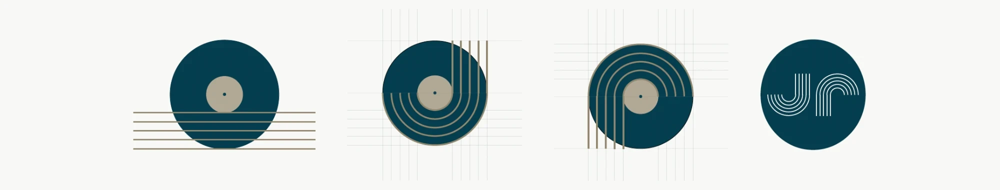

<figcaption>The staff enters the vinyl, turns and forms the J. Rotated 180º, it's the P.</figcaption>

</figure>
<figure class="figure-grid">

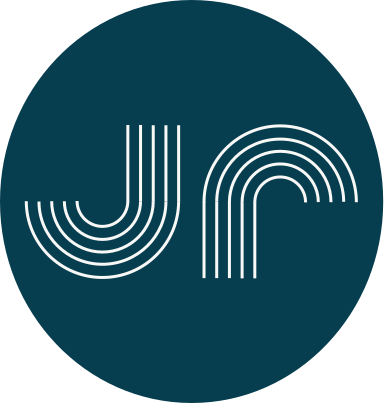

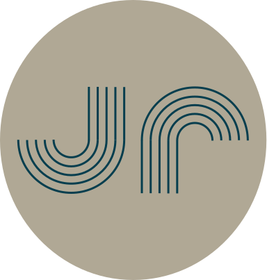

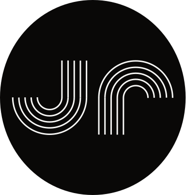

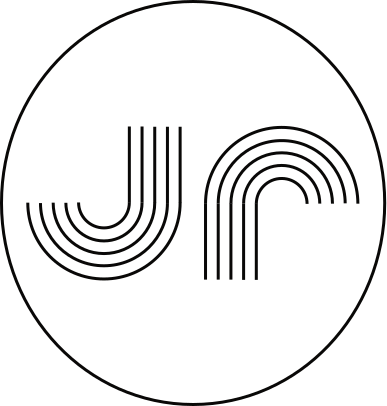

<figcaption>Versions of the icon: with a containing circle, which works as a protection and highlight area, and without a circle, preferred on palette colors.</figcaption>

</figure>

**Typography.** Livvic, at the client's request and in line with the benchmarking (sans-serif). It's light, mixes geometric shapes with humanist touches and has many weights, which let me build a hierarchy with a single family.

<figure>

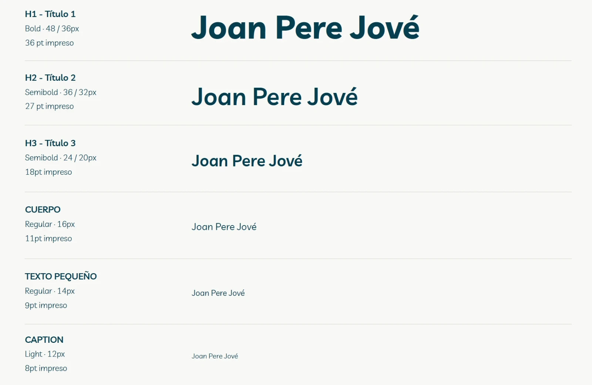

<figcaption>Type hierarchy in Livvic, for web and print.</figcaption>

</figure>

**Color, thought through as a system.** Ocean blue as primary, sand as secondary. I generated the variants by keeping hue and saturation and moving only lightness (0 / 50 / 100), which in practice is a token scale. I avoided pure black and white: they come from the ends of the secondary. The semantic colors keep the saturation and change the hue.

<figure>

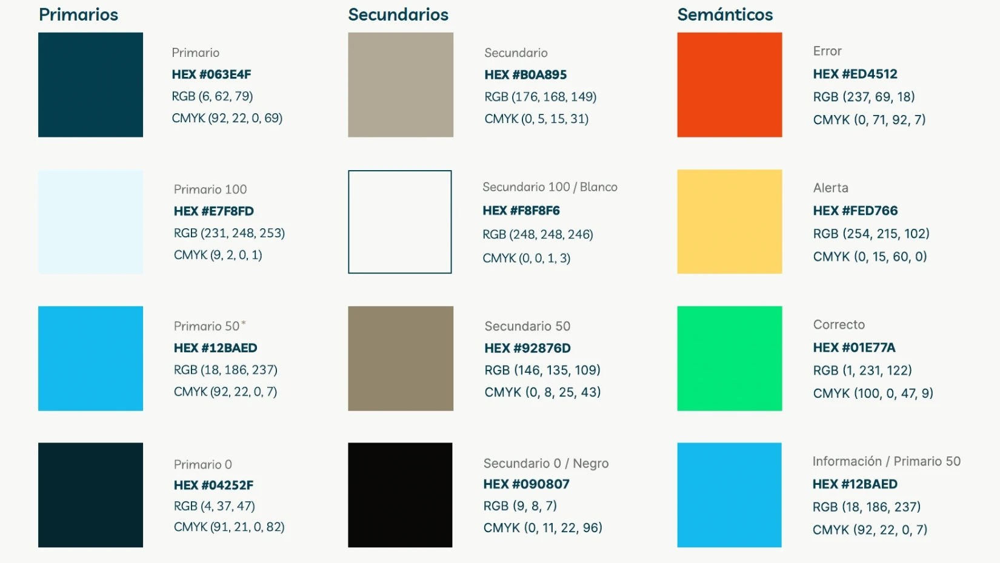

<figcaption>Brand palette: primary, secondary and semantic colors.</figcaption>

</figure>

**Accessibility from the start.** I checked the combinations with WebAIM's contrast checker. The primary/secondary pair passed AA and AAA for bold text and graphics, but only AA for regular text. I documented it as a usage rule: for normal text, it's replaced by the palette's white.

## Information architecture

I took an inventory of the existing website and reorganized it by priority. Joan Pere wanted to position himself above all as a film composer, so I split the content into **Filmografia** and **Altres projectes**, each with its own page.

The home page had to answer two questions without scrolling: *who is he?* and *what does he do?* As Steve Krug says, we don't read pages, we scan them.

Catalan as the main language and English as the second, but **each on its own pages**. It helps users and SEO, and leaves the door open to more languages.

## Prototype

Wireframes in Figma to validate the two flows (desktop and mobile) before adding any styling. A 12-column grid on desktop and 4 on mobile, with a 16px gutter.

<figure class="figure-pair">

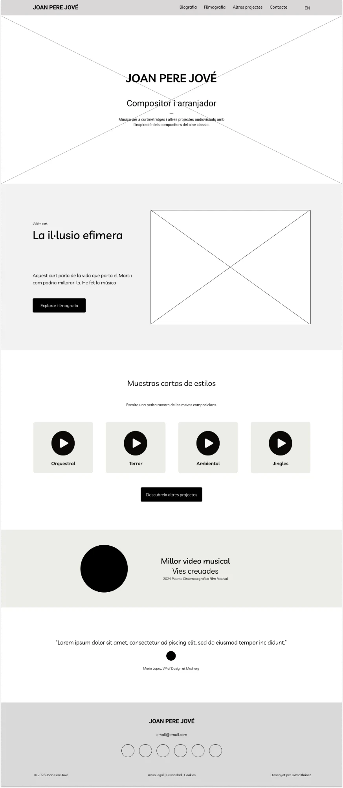

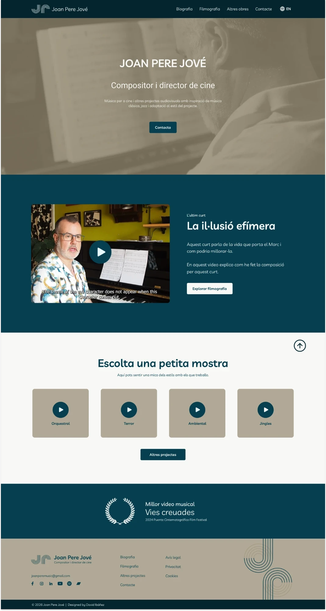

<figcaption>The home page, from wireframe to final design.</figcaption>

</figure>

Then high fidelity, with a few pieces I find the most interesting in the project:

- **Persistent player** at the bottom of the screen, to unify all the audio and let you keep browsing while you listen.
- **Project modal** to show more information without taking the user off the page.
- **UI kit** with header, buttons, cards, form, modal, player and footer, in desktop and mobile versions.

The filmography cards were what cost me the most. They went through several versions because they're the center of the flow: image, title, year and action, all visible before interacting.

<figure class="figure-versions">

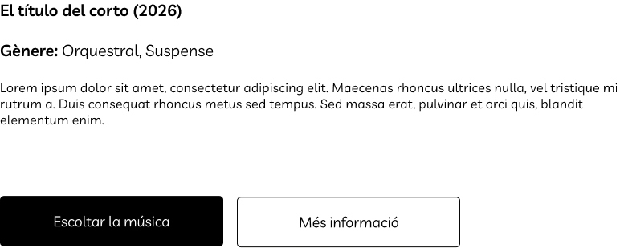

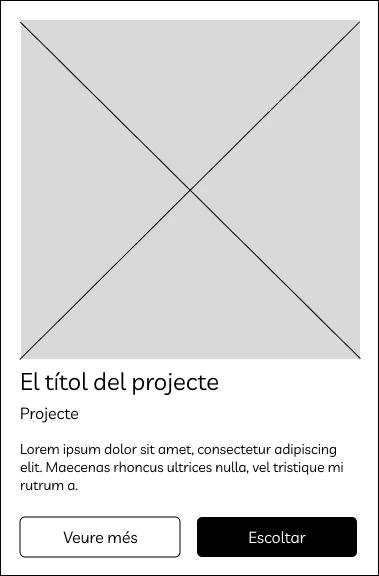

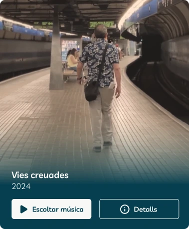

<figcaption>How the card evolved, from the first two wireframes to the final version: image, title, year and action, all visible before interacting.</figcaption>

</figure>

## Validate: AI with a critical eye, and real users

**Heuristic analysis with Claude.** I connected Figma to Claude and asked for an analysis based on Nielsen's heuristics. It helped me move fast and spot improvements (filters, future pagination, footer icons), but it also **got things wrong**: it saw a serif typeface that didn't exist and flagged a "Dossier" that wasn't in the prototype. AI speeds up the work; every conclusion still has to be checked. I added my own analysis based on Gestalt principles.

**User testing in Maze.** Six participants: a senior UX/UI designer, an audiovisual producer, three people with different profiles and the client himself. Four tasks based on Paula's flow:

| Task | Result |
| --- | --- |
| Get to Filmografia from the home page | 5 of 6 with no difficulty, 1 neutral |
| Play a track | Problem found: Maze didn't render the player properly |
| Find the biography | 5 of 6 succeeded |
| Get in touch | 6 of 6 reached the form |

The most valuable part was the qualitative feedback: make the contact button more visible, change the biography photo and, above all, **someone looked for the language selector in the header**. On the live website, that's exactly where it is.

<figure class="figure-pair">

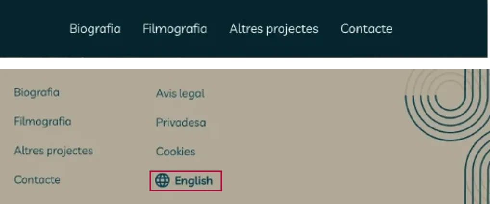

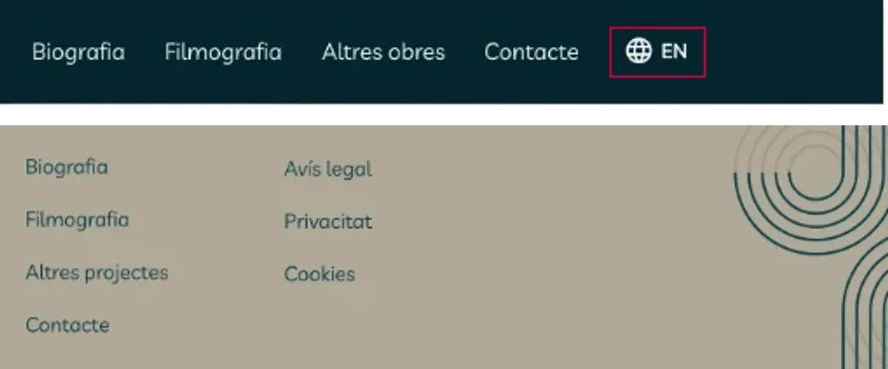

<figcaption>The change after the test. First, you switched language from the footer. Then the selector moved to the header, where people looked for it.</figcaption>

</figure>

## Beyond the website

To show that the system scales, I applied it to other pieces: a physical business card with a QR code that leads to a **virtual card**, Instagram customization and an animated YouTube header. It's all in the brand guidelines.

<figure class="figure-video">
<video src="/videos/joan-pere-jove/cabecera-youtube.mp4" controls muted playsinline preload="metadata" aria-label="Animated YouTube header with Joan Pere Jové's icon"></video>
<video src="/videos/joan-pere-jove/stories-instagram.mp4" controls muted playsinline preload="metadata" aria-label="Instagram stories animation with Joan Pere Jové's icon"></video>
<figcaption>The system in motion: a YouTube header and Instagram stories.</figcaption>
</figure>

## From Figma to production

Joan Pere already knew how to use WordPress and wanted to keep publishing on his own. So, instead of moving him to another tool, I developed a **custom WordPress theme** from the prototype, with the bilingual site managed through Polylang and the language selector in the header, just as the test asked for.

For me, this is the part that best sums up what I do: designing with how it will be built in mind, and building with respect for what was designed.

## What I learned (and what I'd do differently)

- **The brief isn't always the problem.** They asked me for a website and what was needed was a brand.
- **A good color system is a token system.** Defining the palette by lightness made the move to CSS much easier.
- **AI speeds up review.** Useful for moving fast, but everything it suggests has to be checked.
- **My UI kit wasn't ready for handoff.** It ended up as a mix of everything and was missing the form states. Today I'd organize it as a component library with variants and states from day one.
- **Keeping the personal and the professional apart.** Joan Pere is also my husband, but I could separate when I was designing from when we were just living together. Seeing the client happy with the result was the best part.
