## Summary

*Butxaca* means "pocket" in Catalan. LaButxaka is a web app, born as an academic project at UOC, for managing your personal finances on your own: you add, edit and delete transactions, organize them by accounts and categories, and see a summary of how you're doing. The interface is in Spanish, so the screen and button names below stay in Spanish.

I designed and developed it myself from start to finish, and it's the project that best shows how design and code connect: every Figma screen has a controller, a model and a database table behind it.

Finance apps tend to be too complex or to have too many features for people who just want to know where their money goes. I focused the app on the essentials (transactions, accounts, categories, summary) and kept it clear on desktop and on mobile. Today it's a working app I use at home, with a public demo, a video and an interactive tutorial.

---

## Approach

Before opening Figma I did a **benchmark** of other finance apps to see which interface and interaction patterns worked and which were unnecessary. From there I put together a concept map, a phased plan and **user flows** for the three key actions: creating, editing and deleting a transaction.

<figure>

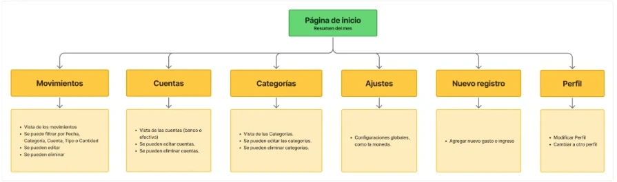

<figcaption>Concept map: from the home page, six sections and what you can do in each.</figcaption>

</figure>

Drawing those flows at the start saved me a lot later: each box in the diagram ended up as a route or a controller method.

<figure>

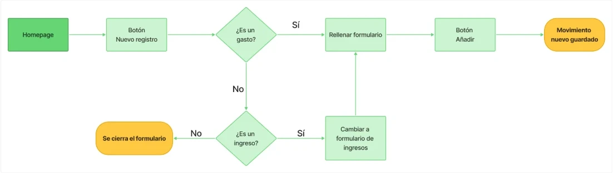

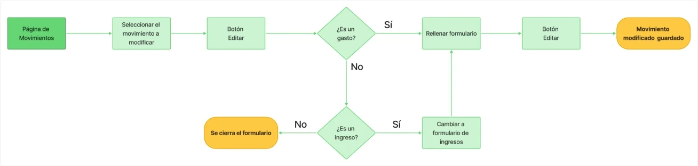

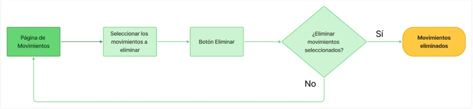

<figcaption>The flows for creating, editing and deleting a transaction.</figcaption>

</figure>

This is how those boxes ended up in `MovimientosController`:

| In the flow | In the code |
| --- | --- |
| Nuevo registro (new entry) button | `create()` |
| Añadir (add) button | `save()` |
| Editar (edit) button, with the transaction selected | `edit()` |
| Editar (edit) button, in the form | `update()` |
| Confirm the deletion | `delete()` |

## Design

I created a **user persona** and a **moodboard** to be clear about who I was designing for and what atmosphere I wanted to convey. With that I defined the style guide (typography, palette and logo).

<figure>

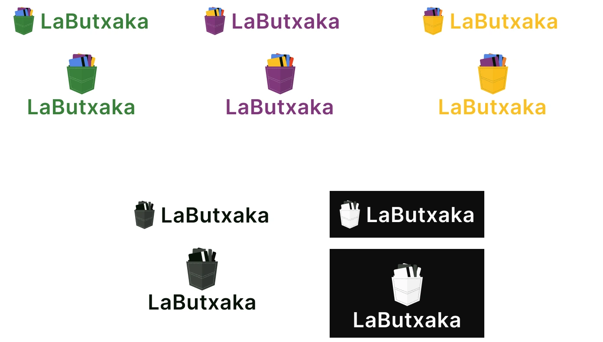

<figcaption>Logo versions: a pocket with cards, in color and in black and white.</figcaption>

</figure>

<figure>

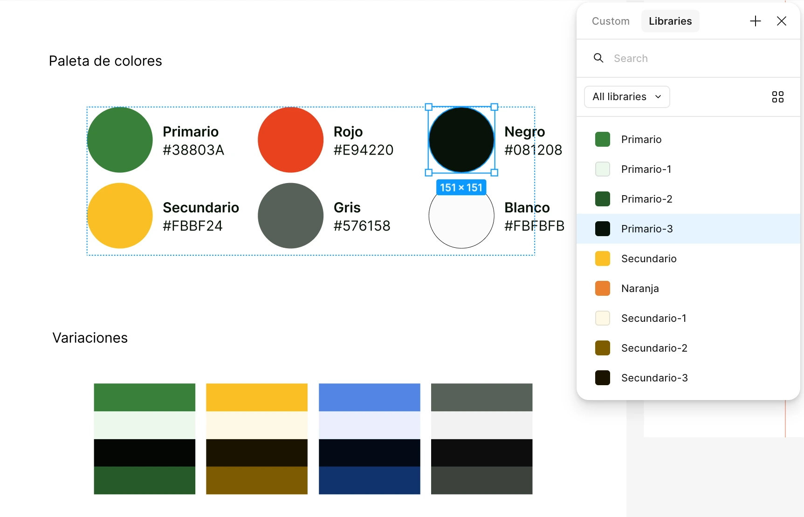

<figcaption>Palette and variations, with the colors saved as variables in Figma.</figcaption>

</figure>

Then, in this order:

1. **Low-fidelity wireframes** to validate structure and flows without getting distracted by styling.
2. **High-fidelity prototype** in Figma, with the style guide applied and the flows prototyped.

<figure class="figure-pair">

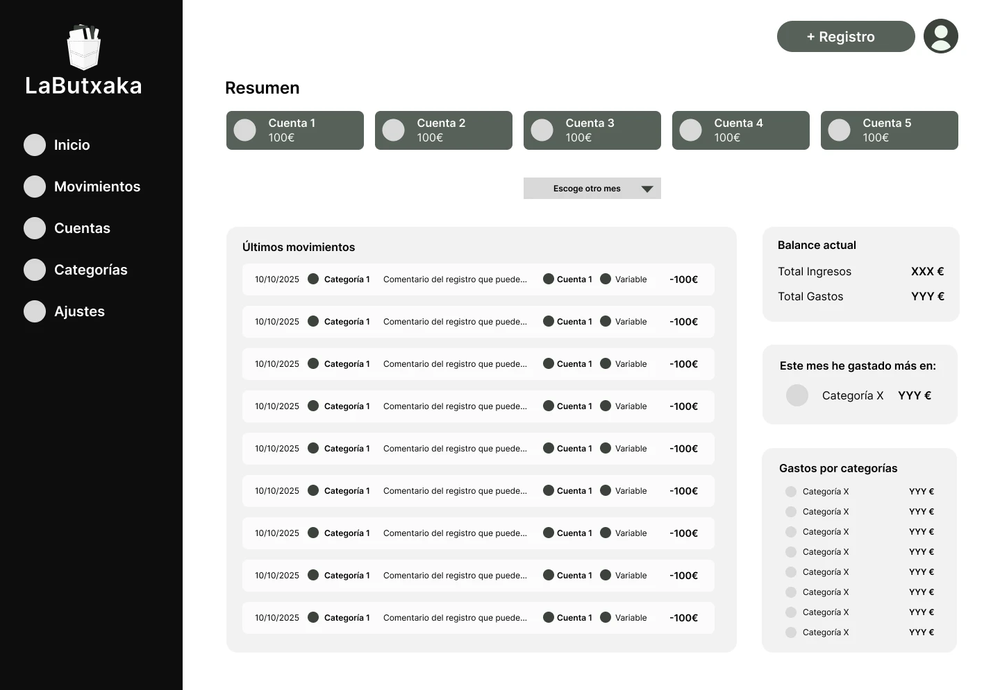

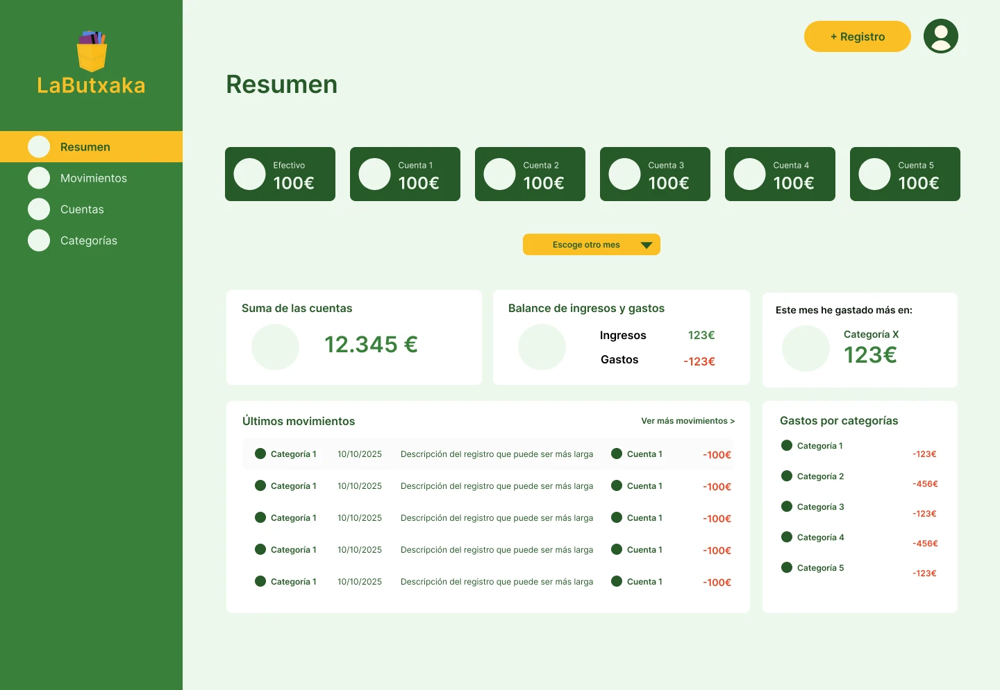

<figcaption>The Resumen (summary) screen, from wireframe to high fidelity.</figcaption>

</figure>

## Development

**Stack:** PHP and SQL on the backend, HTML, CSS and vanilla JavaScript on the frontend, and **Shoelace** components (web components) customized to fit the style guide instead of looking like a generic library.

**MVC architecture.** I chose it with the future in mind: adding forms to manage accounts and categories, filters or sorting should mean adding pieces, not rewriting. Separating model, view and controller also forced me to think of the design as a set of reusable components.

The process, in order:

- Schema for the **relational database** (transactions, categories, accounts and users).
- MVC for transactions, the heart of the app.
- Controllers and models for the other sections.
- Desktop layout: the **Movimientos** and **Resumen** pages.
- Mobile layout and responsive adaptation for tablet.
- **Testing:** tests during development and a smoke test in production.

<figure class="figure-pair">

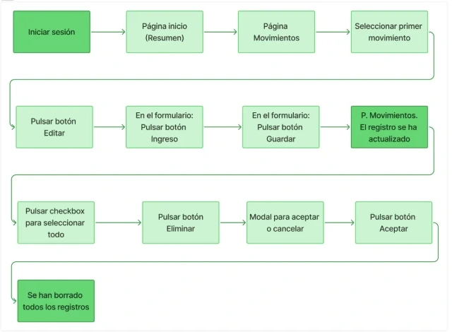

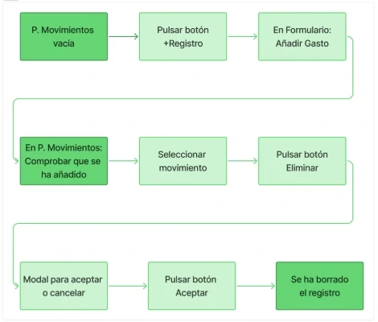

<figcaption>The two smoke test scripts in production.</figcaption>

</figure>

I adjusted Shoelace's variables and parts until the components matched the palette and typography from Figma.

**What got left out.** In the design, Resumen also had a button to filter by date. I ran out of time to apply the changes, so I left it as a pending task in the backlog.

<figure class="figure-pair">

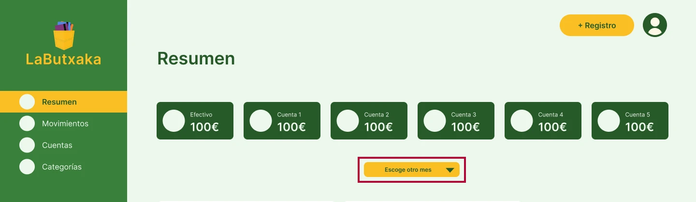

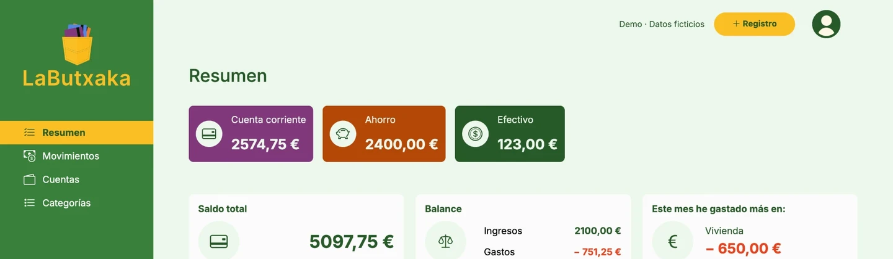

<figcaption>The date filter button in the prototype, and Resumen as built, still without it.</figcaption>

</figure>

## How I presented it to the user

For someone to use the app, they have to understand how it works. I chose two complementary formats:

- **A video**, friendly and visual, that shows what the app does without getting technical.
- **<a href="https://view.genially.com/69595024e2e30838a607ee26" target="_blank" rel="noopener noreferrer">An interactive tutorial</a>** the user can come back to whenever they have questions while using it.

The video introduces the app; the tutorial answers questions once the user is already using it.

## What I learned

- **User flows are technical documentation.** Done well, they're halfway to the architecture.
- **A component library isn't enough as a design system.** Shoelace gave me the accessible, functional base, but I brought the identity by adapting it to my tokens.
- **Thinking about scalability changes how you design.** Knowing there would be more forms in the future made me design patterns, not isolated screens.
- **Next steps:** managing accounts and categories from the interface itself, a date filter in Resumen, and filters and sorting for transactions.
