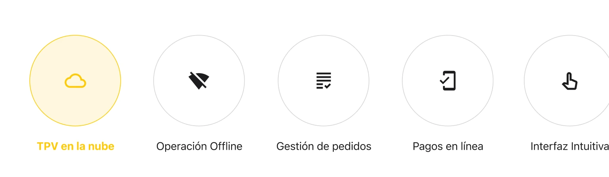
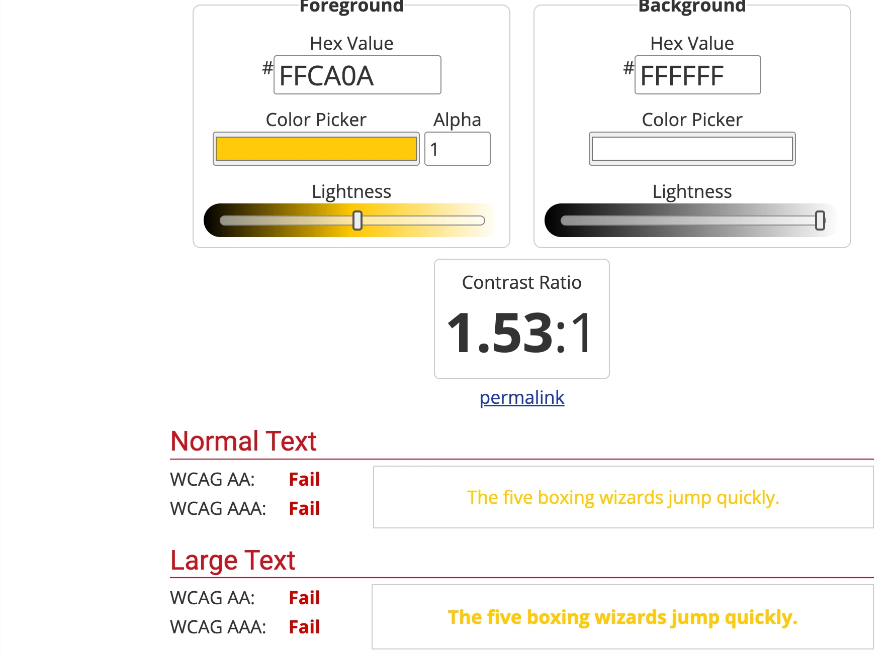

## In short

unPisPas is a cloud POS and QR ordering system for bars, cafés and restaurants. My part was building the frontend of its website from a finished Figma design. **The design was sent by the client.**

## What I did

I built the website in plain HTML, CSS and JavaScript: responsive, with reusable components, dropdown navigation and a language selector.

I left the website ready for six languages, with each one's content injected from JSON. I also prepared a scaffold: when you run it, it generates a new language with the same pages and imports its content from JSON, so adding languages doesn't require rebuilding the layout.

During development, from January to May 2026, I was in contact with the client and the designer. The main changes I asked design for were about accessibility. In everything else I stuck to what was in Figma.

For example, the yellow text on the highlighted button didn't pass contrast on the white background: it came to 1.53:1. I talked to the designer about the accessibility problem: she suggested changing the text to black, and the client confirmed it.

<figure class="figure-stack">

<figcaption>The highlighted button in the design and its contrast check: 1.53:1, short of WCAG AA.</figcaption>

</figure>

## Where my work ended

My part ended with sending the repository, the test URL, a full accessibility audit and the documentation for modifying and running the scaffold. The client published the website in October 2026.
