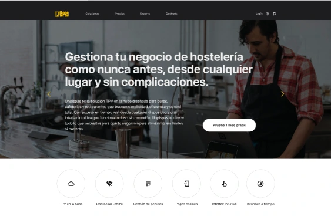
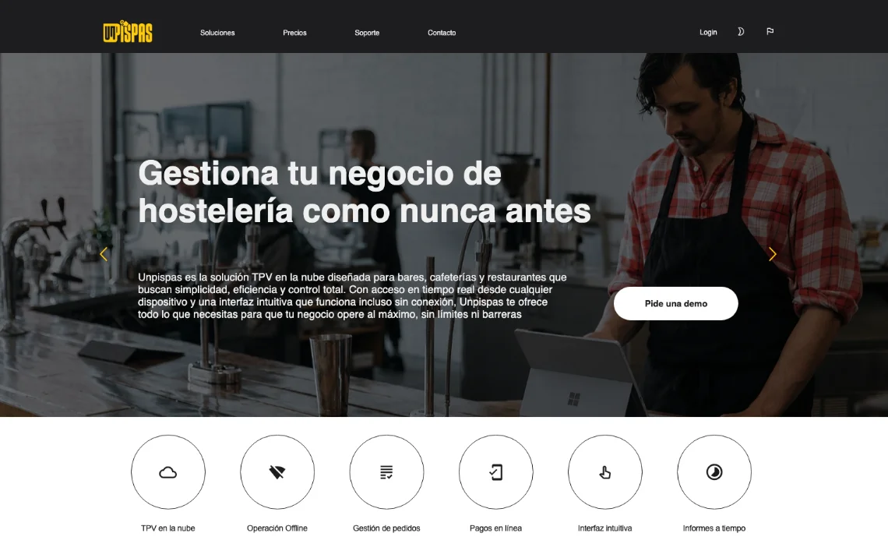

## Summary

unPisPas is a cloud POS and QR ordering system for bars, cafés and restaurants. My part was the frontend: I built the website from a Figma file designed by <a href="https://www.trama22.com/" target="_blank" rel="noopener noreferrer">Julia Carrión</a>.

## What I did

I built the website in plain HTML, CSS and JavaScript: responsive, with reusable components, dropdown navigation and a language selector.

I left the website ready for six languages, with each one's content injected from JSON. I also prepared a scaffold: when you run it, it generates a new language with the same pages and imports its content from JSON, so adding languages doesn't require rebuilding the layout.

During development, from January to March 2026, I was in contact with the client and the designer. Most of what I asked the designer to change was about accessibility. Otherwise I stuck to the Figma design; the client asked for the home page copy changes.

<figure class="figure-pair">

<figcaption>The home page in Figma and the same page on the live website, both in Spanish.</figcaption>

</figure>

For example, the yellow text on the highlighted button didn't pass contrast on the white background: it came to 1.53:1. I talked to the designer about the accessibility problem: she suggested changing the text to black, and the client confirmed it.

<figure class="figure-stack">

<figcaption>The highlighted button in the design and its contrast check: 1.53:1, short of WCAG AA.</figcaption>

</figure>

## Where my work ended

My part ended with sending the repository, the test URL, a full accessibility audit and the documentation for modifying and running the scaffold. The client published the website in October 2026.
