## Resumen

Este proyecto fue mi Trabajo de Fin de Grado en la UOC.

Joan Pere lleva más de diez años componiendo y tres dirigiendo cortometrajes. Tenía web, redes y tarjeta de visita, pero cada pieza iba por su lado. Me pidió rediseñar la web y, al analizarlo todo, vi que el problema era otro: **no había una marca que lo uniera**.

Joan Pere es mi marido, pero en este proyecto la relación fue de cliente.

Así que el proyecto creció: identidad visual, manual de marca, prototipo web testeado con usuarios y la web en producción con un tema de WordPress hecho a medida.

Apliqué un sistema gráfico (logo, tipografía, color y UI kit) a la web, las redes y la papelería. El resultado es <a href="https://joanperejove.com/" target="_blank" rel="noopener noreferrer">joanperejove.com</a>, una web bilingüe catalán/inglés, publicada y en uso.

---

## El punto de partida

La web era una plantilla de WordPress sin personalizar. El catalán y el inglés convivían en las mismas páginas, el menú no tenía una estructura clara y, en la portada, no quedaba claro quién era ni a qué se dedicaba. Las redes funcionaban como un catálogo sin estética común y la tarjeta de visita era un trozo de papel con su contacto.

Mi hipótesis: si todas las piezas comparten el mismo lenguaje visual, la marca se percibe más profesional.

Trabajé con él como con cualquier cliente, con reuniones de revisión en cada fase y decisiones tomadas juntos. Me apoyé en **Design Thinking y codiseño**, porque al final quien tiene que sentirse identificado con la marca es él.

## Descubrir: qué hacen los demás y quién va a entrar

**Benchmarking.** Analicé ocho compositores y compositoras (de Barcelona y alrededores, con equilibrio de género, y Hans Zimmer como referencia internacional). Miré logotipo, paleta, tipografía y coherencia entre web y redes. Casi todos usan la web como catálogo y pocos cuidan la coherencia visual. Ese era el hueco.

Definí dos personas:

- **Paula, 37, productora audiovisual.** Busca compositor para un documental y quiere contactar rápido. Le frustran las webs desactualizadas.
- **Jorge, 26, estudiante de pedagogía musical.** Quiere descubrir música nueva desde el móvil, en el transporte. Le frustra no encontrar dónde darle al play.

Estas dos personas acabaron definiendo los dos flujos principales: contacto en desktop y escucha en mobile.

## Definir la identidad

**Moodboard.** Joan Pere lo tenía claro: nada de fondos oscuros ni de estética corporativa. Quería calma, Mediterráneo, azules, aguamarina, arena. Mi miedo era otro: que con esas palabras clave acabara pareciendo la web de un estudio de yoga o de un resort. Para equilibrarlo, contrasté los azules del mar con los tonos arena, y así la paleta quedó más personal.

**Logotipo.** Al principio él no quería un isotipo con sus iniciales. Probé con figuras musicales hasta que juntando un **pentagrama y un vinilo** salió una J. Girándola 180º, aparecía la P. Le enseñé un boceto rápido y le gustó. Desde ahí hicimos las versiones horizontal, vertical y en negativo.

<figure>

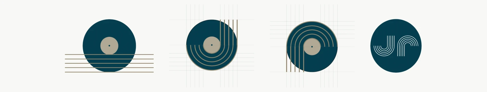

<figcaption>El pentagrama entra en el vinilo, gira y forma la J. Girada 180º, es la P.</figcaption>

</figure>
<figure class="figure-grid">

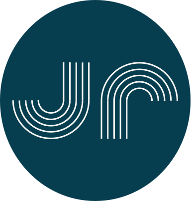

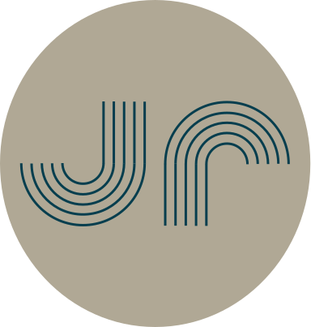

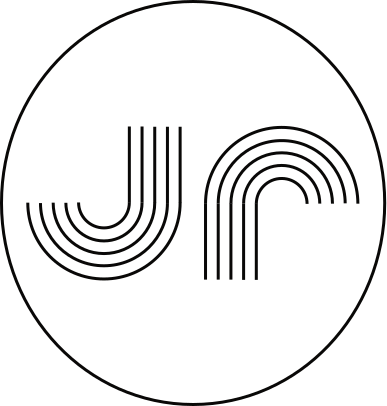

<figcaption>Versiones del isotipo: con círculo contenedor, que sirve como zona de protección y resalte, y sin círculo, que se prioriza sobre colores de la paleta.</figcaption>

</figure>

**Tipografía.** Livvic, a petición del cliente y alineada con el benchmarking (sans-serif). Es ligera, mezcla formas geométricas con matices humanistas y tiene muchos pesos, lo que me permitió construir jerarquía con una sola familia.

<figure>

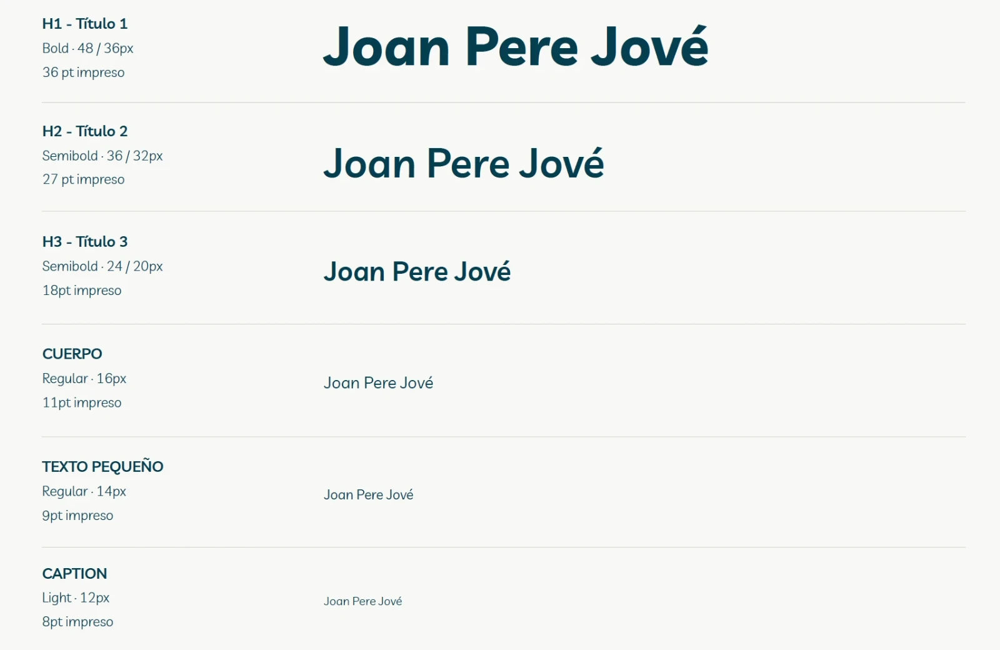

<figcaption>Jerarquía tipográfica en Livvic, para web e impresión.</figcaption>

</figure>

**Paleta de colores.** Primario azul oceánico, secundario arena. Generé las variantes manteniendo tono y saturación y moviendo solo la luminosidad (0 / 50 / 100), lo que en la práctica es una escala de tokens. Evité el negro y el blanco puros: salen de los extremos del secundario. Los colores semánticos mantienen la saturación y cambian el tono.

<figure>

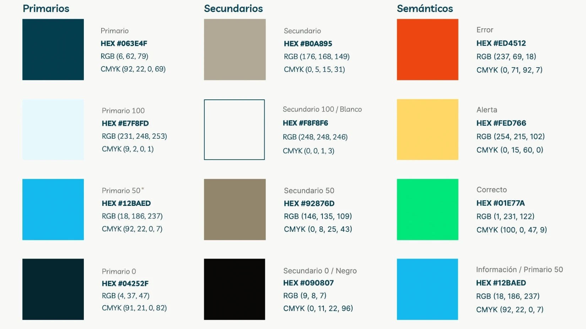

<figcaption>Paleta de la marca: primarios, secundarios y semánticos.</figcaption>

</figure>

**Accesibilidad desde el principio.** Validé las combinaciones con el contrast checker de WebAIM. El par primario/secundario pasaba AA y AAA en texto en negrita y gráficos, pero solo AA en texto regular. Lo dejé documentado como regla de uso: en texto normal, se sustituye por el blanco de la paleta.

## Arquitectura de la información

Hice inventario de la web existente y lo reorganicé con prioridades. Joan Pere quería posicionarse sobre todo como compositor de cine, así que separé el contenido en **Filmografía** y **Altres projectes**, cada uno con su página.

La portada tenía que responder a dos preguntas sin hacer scroll: *¿quién es?* y *¿qué hace?* Como dice Steve Krug, no leemos las páginas, las escaneamos.

Catalán como principal e inglés como secundario, pero **cada uno en sus propias páginas**. Ayuda al usuario, al SEO y deja la puerta abierta a más idiomas.

## Prototipar

Wireframes en Figma para validar los dos flujos (desktop y mobile) antes de meter nada de estilo. Retícula de 12 columnas en desktop y 4 en mobile, con gutter de 16px.

<figure class="figure-pair">

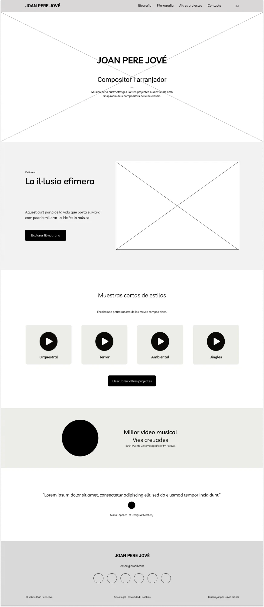

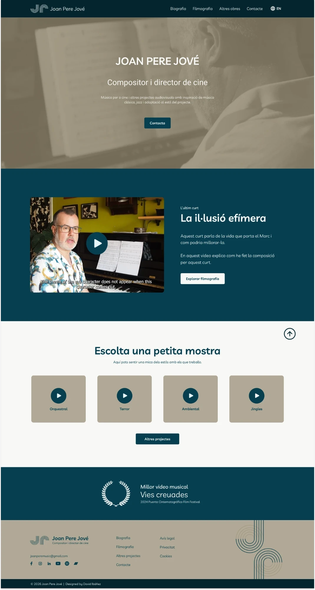

<figcaption>La portada, del wireframe al diseño final.</figcaption>

</figure>

Luego el alta fidelidad. Las tres piezas que más me interesan:

- **Reproductor persistente** en la parte inferior de la pantalla, para unificar todos los audios y que puedas seguir navegando mientras escuchas.
- **Modal de proyecto** para ampliar información sin sacar al usuario de la página.
- **UI kit** con header, botones, tarjetas, formulario, modal, reproductor y footer, en versión desktop y mobile.

Las tarjetas de la filmografía fueron lo que más me costó. Pasaron por varias versiones porque son el centro del flujo: imagen, título, año y acción, todo visible antes de interactuar.

<figure class="figure-versions">

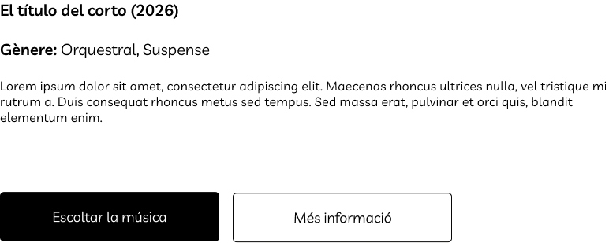

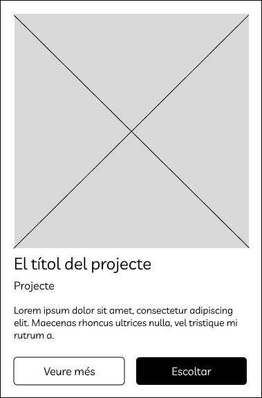

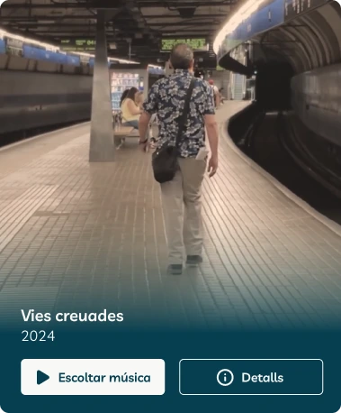

<figcaption>La evolución de la tarjeta, de los dos primeros wireframes a la versión final: imagen, título, año y acción, todo visible antes de interactuar.</figcaption>

</figure>

## Validar: IA con espíritu crítico y usuarios reales

**Análisis heurístico con Claude.** Conecté Figma con Claude y le pedí un análisis según las heurísticas de Nielsen. Me sirvió para ir rápido y detectar mejoras (filtros, paginación futura, iconos del footer), pero también **se equivocó**: vio una tipografía serif que no existía y señaló un "Dossier" que no estaba en el prototipo. La IA acelera el trabajo, y yo reviso cada conclusión. Lo complementé con un análisis propio basado en principios de la Gestalt.

**Test con usuarios en Maze.** Seis participantes: una diseñadora UX/UI senior, un productor audiovisual, tres personas con perfiles distintos y el propio cliente. Cuatro tareas basadas en el flujo de Paula:

| Tarea | Resultado |
| --- | --- |
| Llegar a Filmografía desde la portada | 5 de 6 sin dificultad, 1 neutral |
| Reproducir una pista | Problema detectado: Maze no renderizaba bien el reproductor |
| Encontrar la biografía | 5 de 6 con éxito |
| Contactar | 6 de 6 llegan al formulario |

Lo más valioso fue el feedback cualitativo: hacer más visible el botón de contacto, cambiar la foto de la biografía y, sobre todo, que **alguien buscó el selector de idioma en el header**. En la web publicada, el selector está justo ahí.

<figure class="figure-pair">

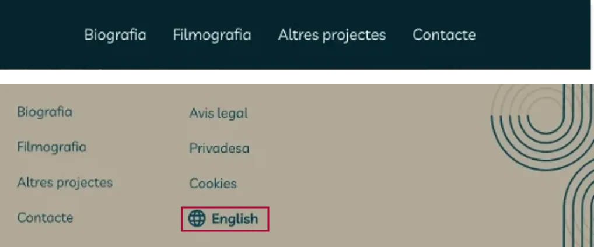

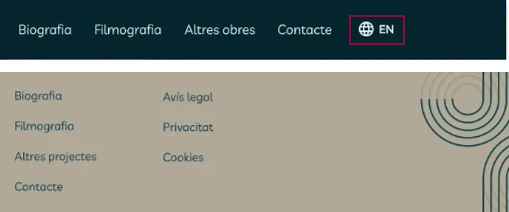

<figcaption>El cambio tras el test. Primero, el idioma se cambiaba desde el pie. Después, el selector pasó a la cabecera, donde lo buscaban.</figcaption>

</figure>

## Más allá de la web

Para demostrar que el sistema escala, lo apliqué a otras piezas: tarjeta de visita física con un QR que lleva a una **tarjeta virtual**, personalización de Instagram y una cabecera animada para YouTube. Todo recogido en el manual de identidad.

<figure class="figure-video">
<video src="/videos/joan-pere-jove/cabecera-youtube.mp4" controls muted playsinline preload="metadata" aria-label="Cabecera animada para YouTube con el isotipo de Joan Pere Jové"></video>
<video src="/videos/joan-pere-jove/stories-instagram.mp4" controls muted playsinline preload="metadata" aria-label="Animación para stories de Instagram con el isotipo de Joan Pere Jové"></video>
<figcaption>El sistema en movimiento: cabecera para YouTube y stories para Instagram.</figcaption>
</figure>

## De Figma a producción

Joan Pere ya sabía usar WordPress y quería seguir publicando él solo. Así que, en lugar de cambiarle de herramienta, desarrollé un **tema de WordPress a medida** a partir del prototipo, con la web bilingüe gestionada con Polylang y el selector de idioma en la cabecera, tal y como pedía el test.

Esta parte resume mi trabajo: diseño pensando en cómo se va a construir y construyo lo que dice el diseño.

## Lo que aprendí (y lo que haría distinto)

- **El encargo no siempre es el problema.** Me pidieron una web y lo que hacía falta era una marca.
- **Un buen sistema de color es un sistema de tokens.** Definir la paleta por luminosidad me facilitó mucho el paso a CSS.
- **La IA acelera la revisión.** Útil para ir rápido, pero contrasto cada cosa que propone.
- **Mi UI kit no estaba listo para un handoff.** Quedó como un *cajón de sastre* y le faltaban los estados del formulario. Hoy lo organizaría como una librería de componentes con variantes y estados desde el primer día.
- **Separar lo personal de lo profesional.** Joan Pere es también mi marido, pero pude separar cuándo estaba diseñando y cuándo estaba conviviendo. Ver al cliente contento con el resultado fue la mejor parte.
