## En resumen

*Butxaca* es "bolsillo" en catalán. LaButxaka es una aplicación web para llevar tus finanzas personales de forma autónoma: añades, editas y eliminas movimientos, los organizas por cuentas y categorías, y ves un resumen de cómo vas.

La diseñé y la desarrollé yo de principio a fin, y es el proyecto donde mejor se ve cómo conectan diseño y código: cada pantalla de Figma tiene detrás un controlador, un modelo y una tabla en la base de datos.

Las apps de finanzas suelen pecar de complejas o de tener demasiadas funciones para quien solo quiere saber en qué se le va el dinero. La solución fue una app enfocada en lo esencial (movimientos, cuentas, categorías, resumen), clara en desktop y en móvil. Hoy es una aplicación funcional en producción, con vídeo demo y tutorial interactivo para el usuario.

---

## Planteamiento

Antes de abrir Figma hice un **benchmarking** de otras apps de finanzas para ver qué patrones de interfaz e interacción funcionaban y cuáles sobraban. A partir de ahí monté un mapa conceptual, una planificación por fases y los **flujos de usuario** para las tres acciones clave: crear, editar y eliminar un movimiento.

<figure>

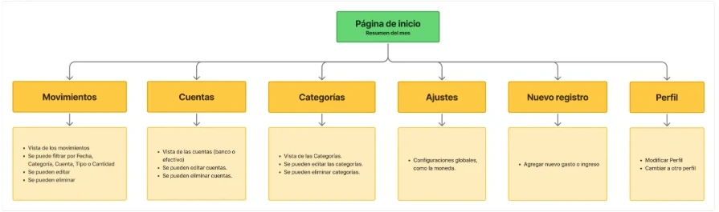

<figcaption>Mapa conceptual: desde la página de inicio, seis secciones y lo que se puede hacer en cada una.</figcaption>

</figure>

Dibujar esos flujos al principio me ahorró mucho después: cada caja del diagrama acabó siendo, casi literalmente, una ruta o un método del controlador.

<figure>

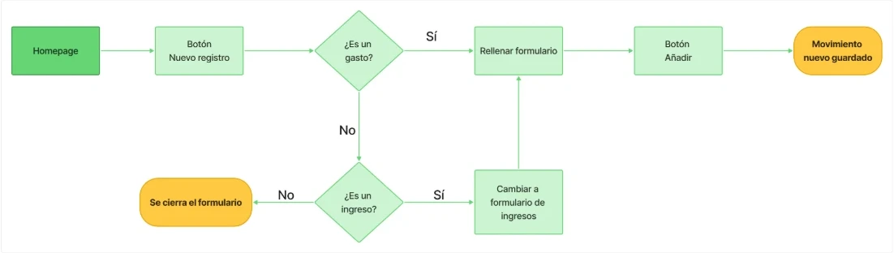

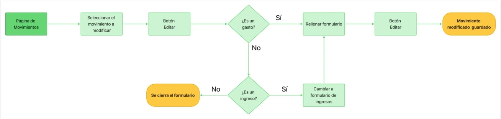

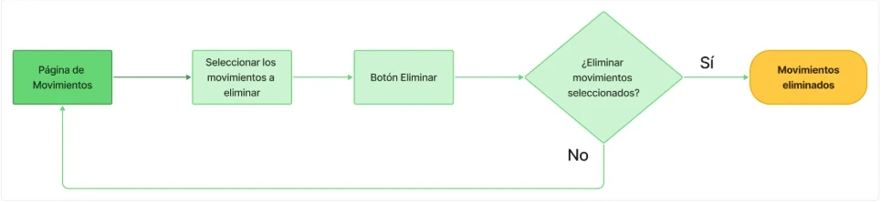

<figcaption>Los flujos de crear, editar y eliminar un movimiento.</figcaption>

</figure>

Así quedaron esas cajas en `MovimientosController`:

| En el flujo | En el código |
| --- | --- |
| Botón Nuevo registro | `create()` |
| Botón Añadir | `save()` |
| Botón Editar, con el movimiento seleccionado | `edit()` |
| Botón Editar, en el formulario | `update()` |
| Confirmar la eliminación | `delete()` |

## Diseño

Creé un **user persona** y un **moodboard** para tener claro para quién diseñaba y qué atmósfera quería transmitir. Con eso definí la guía de estilos (tipografía, paleta y logotipo).

<figure>

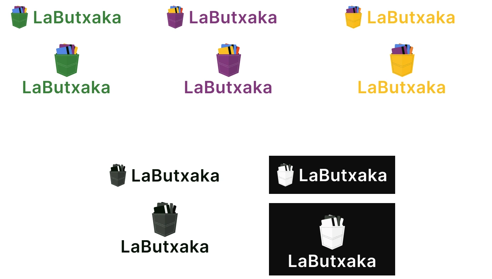

<figcaption>Versiones del logotipo: un bolsillo con tarjetas, en color y en blanco y negro.</figcaption>

</figure>

<figure>

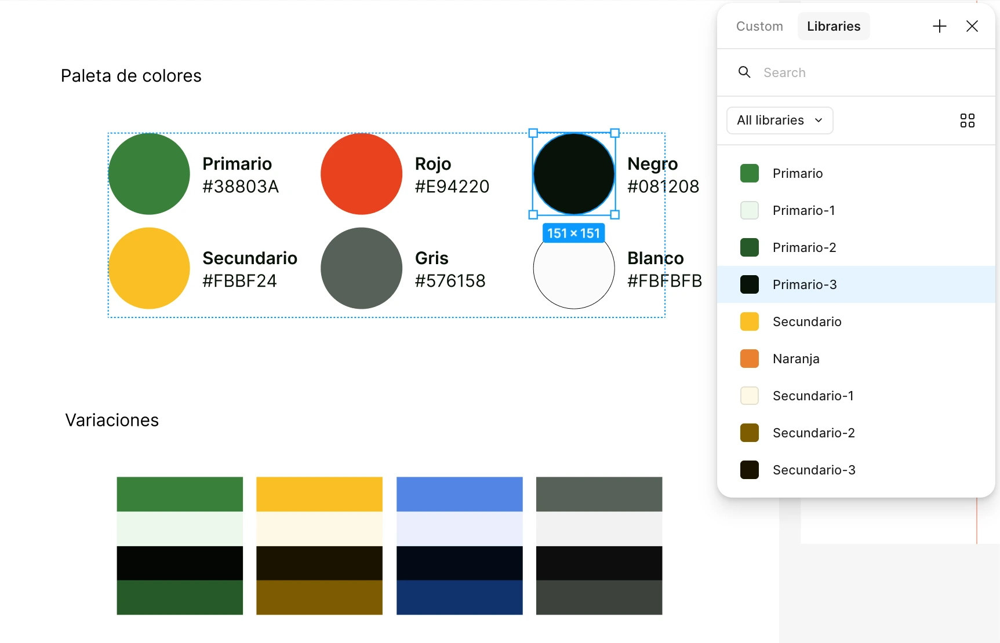

<figcaption>Paleta y variaciones, con los colores guardados como variables en Figma.</figcaption>

</figure>

Después, en este orden:

1. **Wireframes** en baja fidelidad para validar estructura y flujos sin distraerme con el estilo.
2. **Prototipo de alta fidelidad** en Figma con la guía de estilos aplicada y los flujos prototipados.

<figure class="figure-pair">

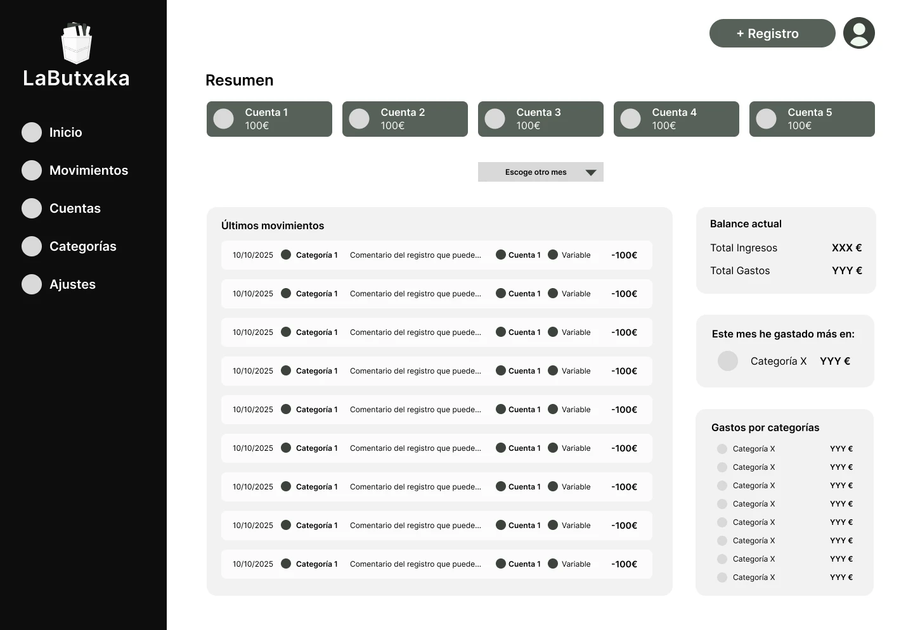

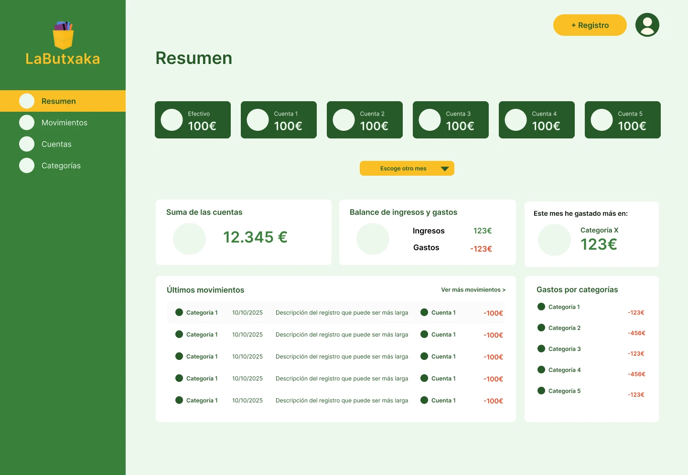

<figcaption>La pantalla Resumen, del wireframe a la alta fidelidad.</figcaption>

</figure>

## Desarrollo

**Stack:** PHP y SQL en el backend, HTML, CSS y JavaScript vanilla en el frontend, y componentes de **Shoelace** (web components) personalizados para que encajaran con la guía de estilos en lugar de parecer una librería genérica.

**Arquitectura MVC.** La elegí pensando en el futuro: añadir formularios para gestionar cuentas y categorías, filtros u ordenaciones tiene que ser sumar piezas, no reescribir. Separar modelo, vista y controlador me obligó también a pensar el diseño como un conjunto de componentes reutilizables.

El proceso, en orden:

- Esquema de la **base de datos relacional** (movimientos, categorías, cuentas y usuarios).
- MVC para los movimientos, que es el corazón de la app.
- Controladores y modelos para el resto de secciones.
- Maquetación desktop: páginas de **Movimientos** y **Resumen**.
- Maquetación mobile y adaptación responsive a tablet.
- **Testing:** pruebas en desarrollo y smoke test en producción.

<figure class="figure-pair">

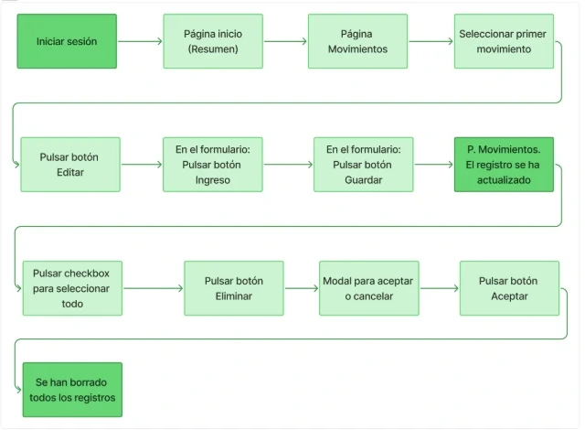

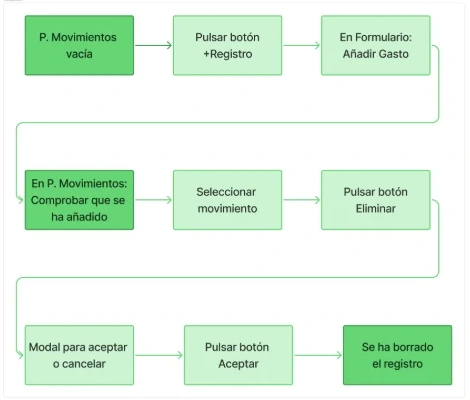

<figcaption>Los dos guiones del smoke test en producción.</figcaption>

</figure>

Personalizar Shoelace enseñó que un componente tiene que sentirse parte del sistema que diseñaste en Figma, no solo funcionar. Ajustar sus variables y partes para respetar la paleta y la tipografía fue donde más se juntaron las dos mitades del proyecto.

**Lo que se quedó fuera.** En el diseño, Resumen también tenía un botón para filtrar por fecha. No daba tiempo a aplicar los cambios, así que lo dejé como tarea pendiente en el backlog.

<figure class="figure-pair">

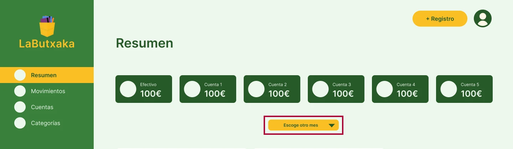

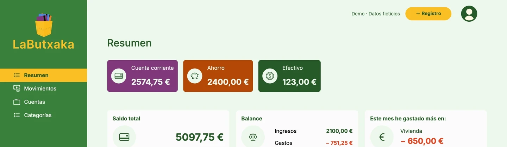

<figcaption>El botón para filtrar por fecha en el prototipo, y Resumen ya construido, todavía sin él.</figcaption>

</figure>

## Cómo lo presenté al usuario

Para que alguien use la app, tiene que entender cómo funciona. Elegí dos formatos complementarios:

- **Un vídeo** cercano y visual, que enseña lo que hace la app sin entrar en tecnicismos.
- **<a href="https://view.genially.com/69595024e2e30838a607ee26" target="_blank" rel="noopener noreferrer">Un tutorial interactivo</a>** al que el usuario puede volver cuando tenga dudas mientras la usa.

El vídeo presenta la app; el tutorial resuelve dudas cuando el usuario ya la usa.

## Lo que aprendí

- **Los flujos de usuario son documentación técnica.** Bien hechos, son medio camino hacia la arquitectura.
- **Una librería de componentes no basta como design system.** Shoelace me dio la base accesible y funcional, pero la identidad la puse yo, adaptándolo a mis tokens.
- **Pensar en escalabilidad cambia cómo diseñas.** Saber que habría más formularios en el futuro me hizo diseñar patrones, no pantallas sueltas.
- **Siguientes pasos:** gestión de cuentas y categorías desde la propia interfaz, filtro por fecha en Resumen, y filtros y ordenación de movimientos.
