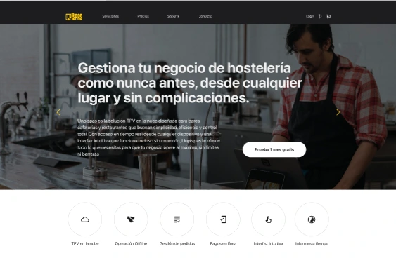
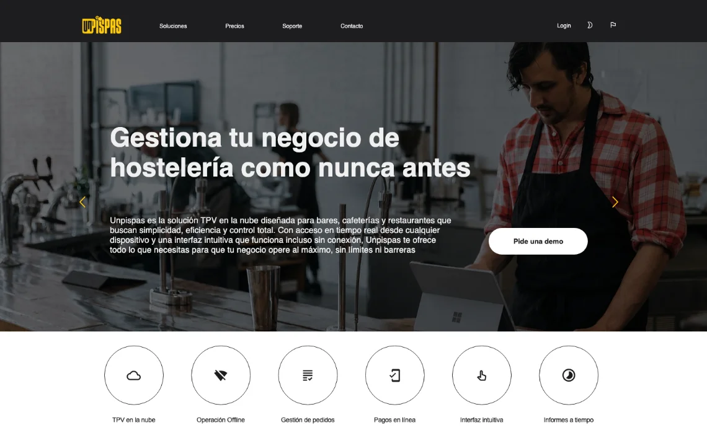
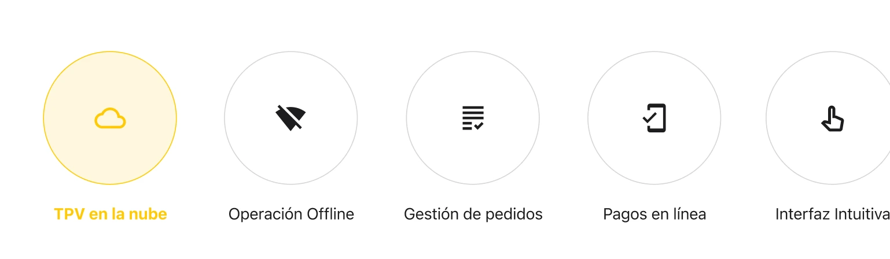
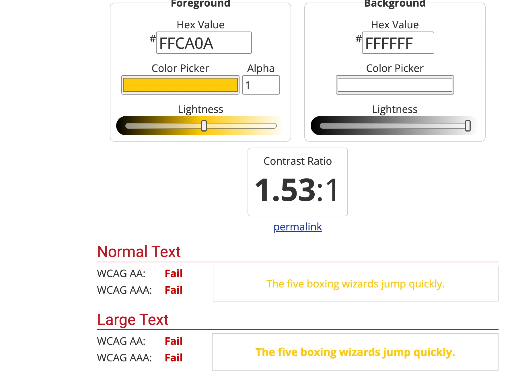

## Resumen

unPisPas es un sistema de TPV en la nube y pedidos por QR para bares, cafeterías y restaurantes. Mi parte fue el frontend: maqueté la web a partir de un Figma diseñado por <a href="https://www.trama22.com/" target="_blank" rel="noopener noreferrer">Julia Carrión</a>.

## Qué hice

Maqueté la web en HTML, CSS y JavaScript puros: responsive, con componentes reutilizables, navegación desplegable y selector de idioma.

Dejé la web preparada para seis idiomas, con el contenido de cada uno inyectado desde JSON. Además, preparé un scaffold: al ejecutarlo genera un idioma nuevo con las mismas páginas, importando su contenido desde JSON, así que añadir idiomas no requiere volver a maquetar.

Durante el desarrollo, de enero a marzo de 2026, estuve en contacto con el cliente y con la diseñadora. La mayoría de los cambios que pedí a la diseñadora fueron de accesibilidad. En el resto respeté el diseño de Figma, los cambios de texto de la portada los pidió el cliente.

<figure class="figure-pair">

<figcaption>La portada en Figma y la misma portada en la web publicada.</figcaption>

</figure>

Por ejemplo, el texto amarillo del botón marcado no pasaba el contraste sobre el fondo blanco: daba 1,53:1. Hablé con la diseñadora sobre el problema de accesibilidad: sugirió cambiar el texto a negro, y el cliente lo confirmó.

<figure class="figure-stack">

<figcaption>El botón marcado en el diseño y su comprobación de contraste: 1,53:1, sin llegar a WCAG AA.</figcaption>

</figure>

## Hasta dónde llegó mi trabajo

Mi parte terminó con el envío del repositorio, la URL de test, una auditoría de accesibilidad completa y la documentación para modificar y ejecutar el scaffold. El cliente publicó la web en octubre de 2026.
